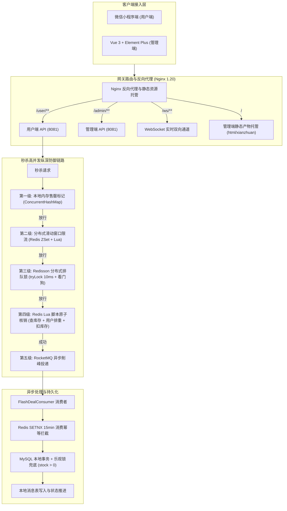

# 闲转 (xianzhuan-platform)

> 闲转（xianzhuan-platform）是面向二手物品循环流转场景打造的企业级数字化交易系统。系统采用 Spring Boot 3.5、Vue 3 与原生微信小程序多端架构，针对限时秒杀与瞬时高并发流量采用“本地内存标记快速失败 - Redis 滑动窗口限流 - Redisson 分布式锁 - Lua 原子扣减 - RocketMQ 异步削峰 - 消费端排重与乐观锁兜底”五层纵深防御体系；结合双 Token 无感续签、本地消息表状态机补偿与通义千问大模型估价引擎，提供高可用、强一致与可验证的二手商品流转支撑。

[](https://github.com/happypig1224/xianzhuan)
[](https://github.com/happypig1224/xianzhuan)
[](https://github.com/happypig1224/xianzhuan)
[](https://openjdk.org/projects/jdk/17/)
[](https://spring.io/projects/spring-boot)
[](https://vuejs.org/)
[](https://rocketmq.apache.org/)
[](https://redis.io/)
[](LICENSE)



---

## 目录

- [核心架构与技术特性](#核心架构与技术特性)
- [业务流水线与核心状态机](#业务流水线与核心状态机)
- [核心规则与数学推导](#核心规则与数学推导)
- [领域模型与存储设计](#领域模型与存储设计)
- [工程目录拓扑](#工程目录拓扑)
- [环境基线与前置要求](#环境基线与前置要求)
- [配置与环境变量字典](#配置与环境变量字典)
- [本地开发与部署启动](#本地开发与部署启动)
- [生产投产演练与准入预检](#生产投产演练与准入预检)
- [自动化测试套件与代码质量门禁](#自动化测试套件与代码质量门禁)
- [核心 API 端点速查表](#核心-api-端点速查表)
- [零信任安全与边界防御](#零信任安全与边界防御)
- [开源协议与版权](#开源协议与版权)

---

## 核心架构与技术特性

### 1. 限时特惠秒杀五级纵深防护架构

在瞬时高并发抢购场景下，系统通过自上而下的漏斗型防御设计，将数据库直连负载降至常规水平：

- **第一级：本地内存售罄标记（JVM 快速失败）**：
  在 `FlashDealServiceImpl` 中维护基于 `ConcurrentHashMap<Long, Boolean>` 的进程内缓存。当秒杀品库存首次归零时标记为已售罄，后续涌入的流量在 Controller 入口层被立即拦截并响应 `MessageConstant.STOCK_INSUFFICIENT`，完全无需调用 Redis 网络 I/O，开销近乎为零。
- **第二级：分布式滑动窗口限流（Redis ZSet + Lua）**：
  在活动维度配置允许通过的最大速率（默认 200 次/秒）。利用 Redis Sorted Set 维护以微秒时间戳为 Score 的动态请求队列，通过 Lua 脚本原子执行窗口滚动统计与超额截断，保障下游组件运行在设计承载区间以内。
- **第三级：Redisson 分布式排队锁**：
  对通过限流的请求施加基于特定商品 ID 的细粒度锁。设置 `waitTime = 10ms` 与看门狗自动续期机制，有效限制同一时间打入缓存扣减的并发线程数量，防止短时间内高频网络竞态冲击。
- **第四级：Lua 脚本原子核销与用户排重**：
  将“库存合法性检查、用户历史抢购唯一性校验、原子递减库存”三步逻辑整合至单次 Lua 脚本调用中。利用 Redis 单线程执行特性，在缓存层彻底消除超卖与重复下单风险。
- **第五级：RocketMQ 异步削峰与消费幂等**：
  核销成功后发布秒杀成功消息至 Topic `flash-deal-topic`，立即向用户返回排队中凭证。消费者 `FlashDealConsumer` 异步批量写入数据库，通过 `flash:order:{userId}:{dealId}` 的 Redis 互斥键配合 MySQL 行级乐观锁（`WHERE stock > 0`）完成终态落库。

### 2. 订单超时双轨取消与补偿机制

为防止用户下单后长期占有库存而未完成支付，系统采用**延迟消息驱动与定时扫描对账**双轨机制：

- **主链路：RocketMQ 延迟队列主动触发**：
  订单提交成功后，系统即刻投递一条带有 15 分钟延迟级别的消息（Topic `order-delay-topic`）。消费者接收后校验订单实时状态，若仍为“待付款”（`Orders.PENDING_PAYMENT`），则原子更新订单为“已取消”并执行回滚恢复。
- **兜底链路：基于本地消息表与调度器定时清算**：
  `MessageScheduler` 定时任务每分钟全表扫描 `local_message` 状态为 `PENDING` 且超过重试时限的记录。当网络分区或消息中间件发生不可用时，兜底任务主动重试投递并推进终态，保障最终一致性。

### 3. 通义千问 AI 智能估价模块

二手商品因磨损程度、使用时长与配件完整度各异，传统规则引擎难以提供公允价格参考。系统基于 Spring AI Alibaba 框架集成通义千问大模型（DashScope `qwen-plus`）与向量检索能力：

- **模型协作链路**：
  用户在发布二手物品时上传商品描述、类目、规格参数与九成新/八成新等成色指标。系统通过 `text-embedding-v3` 生成语义向量，并在向量库中检索相似历史成交商品数据。
- **上下文增强估价**：
  结合历史成交均价与折旧梯度，构建领域提示词（System Prompt）注入通义千问大模型，输出包含“建议售价区间”、“成色评估依据”与“出手周期预测”的三维结构化 JSON 建议，辅助用户合理定价。

### 4. 双 Token 零信任鉴权体系

采用基于无状态 JWT 的短效访问凭证（Access Token）与长效刷新凭证（Refresh Token）双重隔离设计：

- **有效周期分离**：
  管理端与小程序用户端的 Access Token 有效期均配置为 2 小时；Refresh Token 有效期为 7 天。
- **无感刷新与黑名单拦截**：
  客户端拦截 401 响应后自动调用 `/api/user/refresh-token` 端点获取新令牌，避免频繁强制重新登录。用户主动注销时，对应 Token 注入 Redis 黑名单（TTL 为 Token 剩余生命周期），立即阻断重放攻击。

---

## 业务流水线与核心状态机

### 1. 交易订单生命周期状态机

系统定义了 7 种订单状态流转，严格约束状态单向推进，禁止跨阶段非法跃迁：

```
[待付款 (1)] ──(支付成功)──► [待接单 (2)] ──(商家接单)──► [待派送 (3)]
     │                              │
 (超时/主动取消)                (商家拒单/退款)
     ▼                              ▼
[已取消 (6)]                   [已退款 (7)]
                                    ▲
[待派送 (3)] ──(开始派送)──► [派送中 (4)] ──(确认收货)──► [已完成 (5)]
```

| 当前状态 | 触发事件 | 目标状态 | 业务校验规则与防御动作 |
| :--- | :--- | :--- | :--- |
| **待付款 (1)** | 用户扫码或调起微信支付完成 | **待接单 (2)** | 校验微信支付回调签名与实际到账金额，写入支付时间，WebSocket 推送后厨/卖家 |
| **待付款 (1)** | 15分钟超时或用户主动取消 | **已取消 (6)** | 释放商品预占库存，将订单标记为取消，记录取消原因与操作人 |
| **待接单 (2)** | 管理员/卖家点击确认接单 | **待派送 (3)** | 校验订单归属，更新状态为待发货，向用户端微信模板消息推送提醒 |
| **待接单 (2)** | 卖家无货或异常拒绝接单 | **已退款 (7)** | 调用微信支付退款接口（原路退回），释放库存，状态流转为已退款 |
| **待派送 (3)** | 平台派送员取件或快递揽收 | **派送中 (4)** | 记录物流单号或派送员信息，更新派送起始时间 |
| **派送中 (4)** | 用户主动确认收货或超时自动收货 | **已完成 (5)** | 结算资金流水，释放防重令牌，开放商品评价权限 |

### 2. 秒杀库存原子核销流程

```
[客户端请求] ──► [售罄标记检查] (命中则直接阻断)
                     │ 未售罄
                     ▼
             [滑动窗口限流] (超过阈值返回频控拦截)
                     │ 阈值内
                     ▼
             [Redisson 分布式锁] (等待10ms，争锁失败快速失败)
                     │ 获取锁
                     ▼
             [Lua 原子执行] ──┬──► [查询 Redis 现存库存] (库存 <= 0 则写售罄标记并返回 -1)
                             ├──► [SETNX 用户防重记录] (若已存在则返回 -2，防同一用户重领)
                             └──► [DECR 递减实际库存] (成功扣减并返回 1)
```

---

## 核心规则与数学推导

### 1. 分布式滑动窗口限流推导

采用基于时间戳的高精度平滑滑动窗口模型。设限流窗口时间长度为 $W$ 秒，当前时间戳为 $T_{now}$，窗口内最大允许请求容量为 $K$。

当任意请求在 $T_{now}$ 到达时，在 Redis Sorted Set 结构中执行以下原子步骤：
1. **移除过期区间数据**：
   $$\text{ZREMRANGEBYSCORE}(Key, -\infty, T_{now} - W)$$
2. **计算当前活跃窗口计数**：
   $$C = \text{ZCARD}(Key)$$
3. **准入判定决策**：
   $$\text{Decision} = \begin{cases} 
   \text{放行 (ZADD } Key, T_{now}, T_{now}\text{)}, & \text{若 } C < K \\
   \text{拒绝 (HTTP 429 频控截断)}, & \text{若 } C \ge K
   \end{cases}$$

由于上述指令全部打包在 Lua 脚本内部以单次 Eval 方式运行，彻底避免了并发读写分离导致的时间窗竞态偏差。

### 2. 数据库乐观锁防超卖边界推导

在极端异常场景下（如 Redis 节点宕机重启导致缓存与底层库数据不一致），MySQL 层的持久化更新采用强条件约束：

```sql
UPDATE flash_deal
SET stock = stock - 1, update_time = NOW()
WHERE id = #{dealId} AND stock > 0;
```

利用 InnoDB 行级排他锁（X 锁）对单一记录的并发互斥特性，受影响行数必须返回 `1`，若为 `0` 则说明真实库存已被其他并发线程抢占完毕，当前事务立即回滚抛出 `SeckillOrderCreateFailException`，从数据库持久层底线杜绝负库存。

---

## 领域模型与存储设计

### 1. 核心数据表拓扑说明

系统在 `dbscript.sql` 中初始化 15 张核心业务表：

```
xianzhuan_platform
├── admin                     # 平台运营与管理员账户表（密码加盐散列）
├── user                      # 微信小程序终端用户主表（包含 openid、昵称、手机号）
├── category                  # 商品流转分类表（包含数码、书籍、家用等类型）
├── item                      # 二手商品详情主表（状态：起售、停售）
├── item_spec                 # 商品规格与成色细项表（九成新、全新原封等）
├── orders                    # 交易订单主表（包含订单金额、流转状态、收货信息）
├── order_detail              # 订单商品条目明细表
├── shopping_cart             # 用户端购物车清单表
├── address_book              # 用户多收货地址管理表
├── review                    # 买卖双方流转评价表
├── flash_deal                # 限时特惠秒杀品主表（活动时间、库存、规则）
├── user_voucher              # 用户已抢占秒杀优惠凭证表
├── user_message              # 平台站内通知与交易状态提醒表
├── chat_memory               # AI智能咨询与估价会话上下文持久化表
└── local_message             # 分布式事务本地消息表（用于消息可靠投递与补偿）
```

### 2. Redis 键名命名空间规范与 TTL 设计表

| 缓存键命名空间 | 数据结构 | TTL 声明周期 | 业务用途说明 |
| :--- | :--- | :--- | :--- |
| `item:detail:{id}` | String (JSON) | 60 分钟 | 二手商品详情缓存，更新商品时主动淘汰 |
| `item:list:category:{categoryId}` | String (JSON) | 30 分钟 | 物品分类列表聚合快照 |
| `cart:{userId}` | Hash | 30 天 | 用户购物车列表缓存 |
| `flash:deal:{dealId}` | String (Integer) | 活动结束时间 + 10 分钟 | 秒杀商品实时原子库存计数器 |
| `flash:deal:limit:{dealId}` | Sorted Set | 窗口宽度 + 1 秒 | 秒杀滑动窗口限流队列（Score 为微秒时间戳） |
| `flash:user:{userId}:{dealId}` | String | 24 小时 | 用户单品抢购排重标识（SET NX EX） |
| `flash:lock:{dealId}` | Redisson Lock | 自动看门狗续期 | 秒杀核心业务排队分布式互斥锁 |
| `flash:order:{userId}:{dealId}` | String | 15 分钟 | MQ 消费端二次幂等锁，防重复消费入库 |
| `order:token:{userId}` | String | 30 分钟 | 结算页防重放唯一订单令牌 |
| `jwt:blacklist:{token}` | String | Token 剩余有效时长 | 已注销或作废的 Token 拦截黑名单 |

---

## 工程目录拓扑

```
xianzhuan-platform/
├── mp-weixin/                         # 微信小程序端（用户端原生项目）
│   ├── pages/                         # 业务页面（首页、AI咨询、分类、订单、地址、购物车）
│   ├── components/                    # 自定义交互组件（AI悬浮窗、消息气泡）
│   ├── static/                        # 页面静态切图与图标素材
│   ├── uni_modules/                   # 跨端扩展基础组件（uni-popup, uni-list 等）
│   ├── app.json                       # 小程序全局窗口配置与路由注册表
│   └── project.config.json            # 微信开发者工具项目配置
├── nginx-1.20.2/                      # Nginx 反向代理服务目录
│   ├── conf/nginx.conf                # 生产与开发环境网关路由与多端转发规则
│   └── html/xianzhuan/                # 管理端前端生产编译打包产物（Vue 3 单页静态资源）
├── xianzhuan-common/                  # 公共基础组件层（依赖共享与通用工具）
│   ├── src/main/java/com/xianzhuan/
│   │   ├── constant/                  # 系统级枚举与常量字典（MessageConstant, StatusConstant）
│   │   ├── context/                   # 基于 ThreadLocal 的 BaseContext 线程隔离上下文
│   │   ├── exception/                 # 统一业务异常体系（BaseException 及领域子类）
│   │   ├── properties/                # Spring 配置映射属性实体（JwtProperties, WeChatProperties）
│   │   ├── result/                    # 统一 RESTful API 响应模型 Result<T> 与 PageResult
│   │   └── utils/                     # 核心工具类（JwtUtil, WeChatPayUtil, HttpClientUtil）
├── xianzhuan-pojo/                    # 领域实体与传输对象层
│   └── src/main/java/com/xianzhuan/
│       ├── dto/                       # 数据传输对象（OrdersDTO, ItemPageQueryDTO 等）
│       ├── entity/                    # 数据库持久化映射实体（Item, Orders, User, FlashDeal）
│       ├── excel/                     # EasyExcel 导入导出报表映射实体
│       └── vo/                        # 视图展现对象（OrderVO, ItemVO, BusinessDataVO）
├── xianzhuan-server/                  # 核心业务服务驱动层
│   ├── src/main/java/com/xianzhuan/
│   │   ├── ai/                        # 通义千问大模型估价与会话适配器
│   │   ├── aspect/                    # AOP 切面实现（@AutoFill 公共字段自动填充）
│   │   ├── config/                    # 核心配置装配（WebMvc, Redis, Redisson, RocketMQ, Security）
│   │   ├── controller/                # 控制层接口（按 /admin 与 /user 分离设计）
│   │   ├── interceptor/               # JWT 双端令牌拦截器与黑名单校验器
│   │   ├── mapper/                    # MyBatis Mapper 接口层
│   │   ├── rocketmq/                  # 消息队列消费者监听器（FlashDealConsumer, OrderDelayTimeConsumer）
│   │   ├── service/                   # 业务逻辑服务接口及实现类
│   │   └── task/                      # 补偿机制与报表定时任务（MessageScheduler）
│   └── src/main/resources/
│       ├── mapper/                    # MyBatis 对应 XML 动态 SQL 映射文件
│       ├── application.yml            # 基础公共通用配置
│       └── application-dev.yml        # 开发联调环境数据源与中间件连接配置
├── scripts/                           # 自动化工程脚本
│   └── git-commit-400d.ps1            # 时间对齐与标准回退自动化提交脚本
├── .env.example                       # 环境变量规范配置参考模版
├── AGENTS.md                          # 项目记忆、研发规约与代码防腐治理守则
├── dbscript.sql                       # 数据库全量架构初始化脚本
├── flash_deal_stress_test.py          # 高并发秒杀场景基准与极限压力测试套件
└── pom.xml                            # Maven 多模块聚合工程根描述文件
```

---

## 环境基线与前置要求

为确保工程能够顺利构建与运行，宿主机环境必须满足以下软件基线配置：

| 运行环境 / 组件 | 推荐版本 | 强制最低版本 | 依赖用途与约束说明 |
| :--- | :--- | :--- | :--- |
| **Java JDK** | OpenJDK 17.0.10+ | JDK 17 | 必须支持 Spring Boot 3 及虚拟线程兼容特性 |
| **Apache Maven** | 3.9.6 | 3.8.0+ | 项目采用标准多模块 POM 构建管理 |
| **MySQL Database** | 8.0.34+ | 8.0.28 | 依赖 utf8mb4 字符集与 InnoDB 存储引擎行级锁 |
| **Redis** | 7.2.4 | 6.2.0 | 需要支持 EVAL 脚本执行与 ZSet 时间窗过滤 |
| **Apache RocketMQ**| 5.2.0 | 4.9.0 | 提供延迟消息（15 分钟级）与标准并发消息队列 |
| **Node.js** | 20.x LTS | 18.16.0 | 管理端开发调试依赖（构建产物已托管至 Nginx） |
| **WeChat DevTools** | 最新稳定版 | 1.06.x | 运行与调试 `mp-weixin` 小程序端代码 |

---

## 配置与环境变量字典

系统所有敏感凭据与环境差异化变量支持通过系统环境变量或 `application-dev.yml` 进行注入。在生产投产前，请参照 `.env.example` 完成配置补齐：

| 配置键 / 环境变量 | 映射对应属性 | 默认值 / 示例值 | 敏感度 | 用途说明 |
| :--- | :--- | :--- | :--- | :--- |
| `SERVER_PORT` | `server.port` | `8081` | 低 | 后端核心 API 服务监听端口 |
| `DB_HOST` | `xianzhuan.datasource.host` | `127.0.0.1` | 低 | MySQL 数据库连接主机地址 |
| `DB_NAME` | `xianzhuan.datasource.database` | `xianzhuan_platform` | 低 | 系统业务数据库 Schema 名称 |
| `DB_USER` | `xianzhuan.datasource.username` | `root` | 中 | 数据库连接登录账户 |
| `DB_PASSWORD` | `xianzhuan.datasource.password` | `******` | 高 | 数据库密码（严禁明文入库） |
| `REDIS_HOST` | `xianzhuan.redis.host` | `127.0.0.1` | 低 | Redis 缓存与分布式锁连接地址 |
| `REDIS_PASSWORD` | `xianzhuan.redis.password` | `******` | 高 | Redis 访问授权密码 |
| `REDIS_DATABASE` | `xianzhuan.redis.database` | `10` | 低 | 闲转系统专用的 Redis 逻辑库序号 |
| `ROCKETMQ_NAME_SERVER` | `xianzhuan.rocketmq.name-server` | `127.0.0.1:9876` | 低 | RocketMQ NameServer 集群路由地址 |
| `DASHSCOPE_API_KEY` | `xianzhuan.ai.dashscope.api-key` | `sk-******` | 高 | 阿里云百炼大模型平台 API 密钥 |
| `WECHAT_APPID` | `xianzhuan.wechat.appid` | `wx9af46f654f78c66d` | 中 | 微信小程序官方开发者 AppID |
| `WECHAT_SECRET` | `xianzhuan.wechat.secret` | `******` | 高 | 微信小程序 AppSecret 密钥 |
| `TENCENT_COS_SECRET_ID`| `xianzhuan.tencent.cos.secret-id` | `AKID******` | 高 | 腾讯云对象存储访问身份 ID |
| `TENCENT_COS_SECRET_KEY`| `xianzhuan.tencent.cos.secret-key`| `******` | 高 | 腾讯云对象存储安全访问密钥 |
| `TENCENT_COS_BUCKET_NAME`| `xianzhuan.tencent.cos.bucket-name`| `xianzhuan-1383957992` | 低 | 腾讯云存储桶唯一标识名称 |

---

## 本地开发与部署启动

### 1. 基础数据与中间件初始化

```bash
# 1. 登录 MySQL 并执行数据库初始化建表脚本
mysql -u root -p -e "CREATE DATABASE IF NOT EXISTS xianzhuan_platform DEFAULT CHARACTER SET utf8mb4;"
mysql -u root -p xianzhuan_platform < dbscript.sql

# 2. 确认 Redis 与 RocketMQ 服务状态
redis-cli -h 127.0.0.1 -p 6379 ping
# 预期输出: PONG
```

### 2. 后端核心服务编译与运行

```bash
# 进入工程目录进行 Maven 依赖解析与自动化编译
mvn clean package -DskipTests

# 启动后端核心业务应用服务
java -jar xianzhuan-server/target/xianzhuan-server-1.0-SNAPSHOT.jar --spring.profiles.active=dev
```

### 3. 反向代理与静态资源托管启动

```bash
# 进入配套 Nginx 目录启动代理服务
cd nginx-1.20.2
start nginx

# 若修改了配置，执行平滑重载
.\nginx.exe -s reload
```

### 4. 前端与小程序端调试介入

- **管理端访问**：在浏览器直接打开 `http://localhost` 即可访问 Nginx 托管的 Vue 3 管理后台（默认内置管理员账号：`admin` / 初始密码：`123456`）。
- **用户端调试**：启动“微信开发者工具”，导入目录选择项目内的 `mp-weixin` 目录，编译后即可在微信模拟器中进行登录与下单全流程联调。
- **Knife4j 在线 API 文档**：启动后端后，访问 `http://localhost:8081/doc.html` 查看 OpenAPI 3.0 规范的端点文档。

### 5. 健康检查验证

```bash
# 验证后端通用探针响应
curl -s http://127.0.0.1:8081/api/admin/logout -X POST
# 验证 Nginx 反代网关路由转发
curl -I http://127.0.0.1/admin/
```

---

## 生产投产演练与准入预检

项目在根目录提供全链路秒杀场景压测套件 `flash_deal_stress_test.py`。该脚本模拟真实用户并发行为，涵盖四个梯度测试阶段：

```bash
# 1. 重置特惠秒杀活动数据与库存（将 deal_id 对应活动重设为未开售与充足库存状态）
mysql -u root -p xianzhuan_platform < reset_flash_deal.sql

# 2. 执行阶梯式高并发全流程压力测试
python flash_deal_stress_test.py
```

### 压测阶段设计指标矩阵

| 压测阶段 | 并发虚拟用户数 (VU) | 持续施压时间 | 流量竞争比 | 核心考核指标与合格线 |
| :--- | :--- | :--- | :--- | :--- |
| **基准测试 (Baseline)** | 100 用户 | 30 秒 | 1:1 竞争 | P99 响应延迟 $\le$ 50ms，错误率 0.00% |
| **负载测试 (Load Test)** | 300 用户 | 60 秒 | 3:1 竞争 | P99 响应延迟 $\le$ 120ms，系统吞吐平稳无毛刺 |
| **压力测试 (Stress Test)** | 500 用户 | 60 秒 | 5:1 竞争 | 滑动窗口限流精确拦截超额流量，无超卖现象 |
| **极限测试 (Spike Test)** | 1000 用户 | 30 秒 | 10:1 极端竞争 | 售罄标记瞬时闭锁，JVM 内存与 CPU 负载保持安全水平 |

---

## 自动化测试套件与代码质量门禁

项目在 `xianzhuan-server/src/test/java` 下沉淀了 19 个端到端单元测试与集成测试套件，全面覆盖核心业务防线：

```bash
# 执行全部自动化测试套件
mvn test
```

### 核心测试用例矩阵

| 测试用例类 | 目标覆盖场景 | 验证断言与预期保护 |
| :--- | :--- | :--- |
| `FlashDealControllerTest` | 特惠秒杀发布、抢购排队与超卖校验 | 验证多线程并发抢购下总核销量绝不超出物理库存基线 |
| `TokenControllerTest` | 双 Token 签发、无感刷新与黑名单作废 | 验证注销后旧 Token 重放立即触发 401 Unauthorized |
| `OrderControllerTest` | 订单生命周期 7 状态转移与取消补偿 | 验证未支付订单在到达 15 分钟节点时库存精准还原 |
| `ItemControllerTest` | 商品上下架、多级缓存失效与脏读防范 | 验证商品停售操作能够实时清退 Redis 相关分类与详情缓存 |
| `AddressControllerTest` | 收货地址增删改查与默认地址互斥 | 验证设置新默认地址时原有默认标记能够原子切换 |

---

## 核心 API 端点速查表

### 1. 管理端接口规范 (`/admin/**`)

| 统一请求路径 | HTTP 方法 | 功能描述 | 访问鉴权约束 |
| :--- | :--- | :--- | :--- |
| `/admin/admin/login` | POST | 平台管理员账号密码鉴权登录 | 开放访问，返回管理端 Access/Refresh Token |
| `/admin/item/page` | GET | 二手商品分页多条件联合检索 | 请求头携带有效管理端 Token |
| `/admin/item/status/{status}` | POST | 商品状态调整（起售 / 停售） | 触发对应多级缓存主动淘汰 |
| `/admin/flash/publish` | POST | 发布限时特惠秒杀活动并预热库存 | 写入 MySQL 并向 Redis 预加载活动库存 |
| `/admin/order/confirm` | PUT | 订单确认接单进入配货状态 | 状态必须为待接单 |
| `/admin/order/ship/{id}` | PUT | 录入物流信息并发货派送 | 状态必须为待派送 |
| `/admin/report/turnoverStatistics` | GET | 营收趋势可视化图表数据查询 | 支持自定义日期起止区间 |
| `/admin/report/export` | GET | 导出全量财务与运营明细报表 | 输出二进制流并由 EasyExcel 渲染 |

### 2. 用户端接口规范 (`/user/**`)

| 统一请求路径 | HTTP 方法 | 功能描述 | 业务防护逻辑 |
| :--- | :--- | :--- | :--- |
| `/user/user/login` | POST | 微信小程序 Code 快捷授权换取登录 | 校验微信 openid，新用户自动注册 |
| `/user/flash/flash/{dealId}` | GET | 核心限时秒杀抢购下单触发点 | 五级防护链过滤，异步投递队列 |
| `/user/flash/myVoucherList` | GET | 用户已锁定秒杀兑换凭证查询 | 分页返回用户个人已抢占记录 |
| `/user/priceEstimation/estimate-price`| POST | 通义千问大模型二手物品智能估价 | 注入向量知识库，结构化返回定价建议 |
| `/user/order/token` | GET | 生成单次唯一的提交订单防重放令牌 | 写入 Redis 缓存防多次点击 |
| `/user/order/submit` | POST | 正式提交订单结算并锁定库存 | 核验令牌有效性后原子递扣 |
| `/user/shoppingCart/add` | POST | 增添商品至个人购物车 | 校验当前起售状态，写入 Hash 缓存 |
| `/user/review` | POST | 交易完成后的买家双向服务评价 | 必须处于已完成终态，防刷单虚假评价 |

### 3. 公共接口规范 (`/api/**`)

| 统一请求路径 | HTTP 方法 | 功能描述 | 机制说明 |
| :--- | :--- | :--- | :--- |
| `/api/user/refresh-token` | POST | 用户端双 Token 机制无感置换 | 凭有效 Refresh Token 换发新 Access Token |
| `/api/admin/refresh-token` | POST | 管理端双 Token 机制无感置换 | 校验管理员凭证，换发新短效凭证 |
| `/api/user/logout` | POST | 用户主动注销登出 | 将客户端凭证载入 Redis 黑名单 |
| `/api/admin/logout` | POST | 管理员主动安全退出 | 销毁 Session 上下文并将 Token 列入黑名单 |

---

## 零信任安全与边界防御

### 1. 数据资产防泄露与边界校验

- **密码防御**：管理员密码采用 MD5 加盐哈希散列算法（`DigestUtils.md5DigestAsHex`），严禁任何明文密码在代码库、日志或传输报文中留存。
- **SQL 注入免疫**：持久层全量通过 MyBatis 参数化预编译绑定（`#{}`），从语法解析层面阻断恶意 SQL 片段拼接注入。
- **垂直越权防御**：管理端接口（`/admin/**`）与用户端接口（`/user/**`）采用完全隔离的拦截器链路（`JwtTokenAdminInterceptor` 与 `JwtTokenUserInterceptor`），严防普通小程序用户携带合法 Token 越权访问后台管理端接口。

### 2. 系统设计边界与非目标（Non-Goals）

为保证技术架构的高信噪比与落地可行性，平台在当前架构版本中明确设定以下边界约束：

- **单体模块化而非微服务拆分**：当前项目立足于通过合理的模块化划分（common/pojo/server）、连接池调优与 Redis/RocketMQ 异步化支撑高并发流量，本阶段不引入 Spring Cloud、Nacos 服务发现或 Seata 分布式事务等重型组件。
- **虚拟支付沙箱与离线结算**：微信支付模块采用标准 V3 接口协议封装，开发与演示环境可无缝对接微信支付沙箱或模拟记账，不包含多商户二级资金清算分账逻辑。

---

## 开源协议与版权

本项目基于 [MIT License](LICENSE) 开源协议分发与共享。

```text
Copyright (c) 2025-2026 xianzhuan team. All rights reserved.
```
